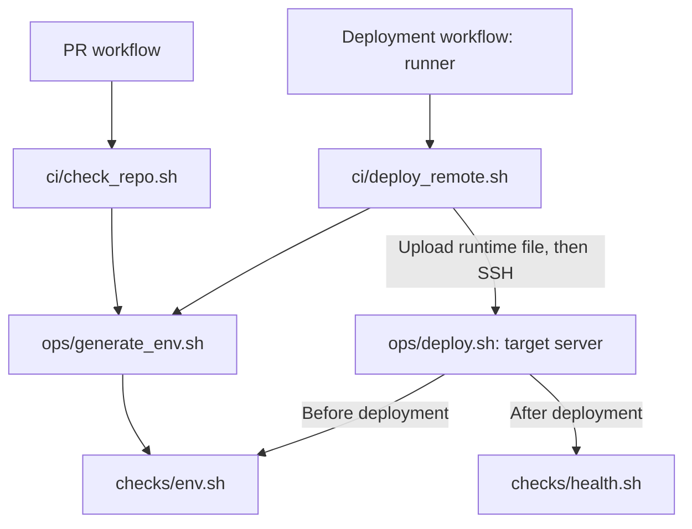

# Infrastructure scripts

Run the examples below from the `infra/` directory. Scripts resolve repository
files relative to their own location, so they can also be invoked by absolute path.

## Choose a command

| Task | Command | Where to run it |
|------|---------|-----------------|
| Prepare local configuration | `./scripts/ops/generate_env.sh local` | Developer machine |
| Deploy local services | `./scripts/ops/deploy.sh local` | Developer machine |
| Redeploy the installed staging configuration | `./scripts/ops/deploy.sh staging` | Target server |
| Stop an environment | `./scripts/ops/deploy.sh staging stop` | Target server |
| Validate a runtime file | `./scripts/checks/env.sh local` | Machine containing that file |
| Diagnose service health | `./scripts/checks/health.sh staging` | Target server |
| Exercise the API user journey | `./scripts/checks/user_flow.sh local fresh-test@example.com` | Developer machine |
| Create a database backup | `./scripts/ops/db.sh backup production` | Target server; also usable from cron |
| List backups | `./scripts/ops/db.sh list production` | Target server |
| Restore a backup | `./scripts/ops/db.sh restore staging /path/to/backup.sql.gz` | Target server |
| Check a repository change | `./scripts/ci/check_repo.sh` | Developer machine or PR runner |

Commands accepting an environment support `local`, `staging`, and `production`,
except `ci/deploy_remote.sh`, which supports staging and production only.
The user-flow check requires a fresh email address with an inbox you can read.
It requests a registration code, prompts for that code, then creates a test account
and application data. Cleanup runs on exit, including failed steps, and removes
only the resources/account created by this run. It runs only when explicitly
requested, not as part of deployment. Both HTTP checks require `jq` for JSON.
Cleanup failures are reported; interrupted networking may still require manual cleanup.

## Responsibilities and automatic calls

Folders describe responsibilities, not exclusive manual/automatic usage.

| Script | Usual caller | Calls automatically |
|--------|--------------|---------------------|
| `ci/check_repo.sh` | PR workflow; optionally a developer | `ops/generate_env.sh` for all environments, with dummy CI secrets |
| `ci/deploy_remote.sh` | Staging/production deployment workflow, on the runner | `ops/generate_env.sh`, then `ops/deploy.sh` on the server over SSH |
| `ops/generate_env.sh` | Developer or either CI entry point | `checks/env.sh` before writing the final file |
| `ops/deploy.sh` | Operator or remote deployment script | `checks/env.sh`, deployment, then `checks/health.sh` |
| `ops/db.sh` | Operator; cron for backups | No other repository scripts |
| `checks/env.sh` | Generator, deployment, or operator | No other repository scripts |
| `checks/health.sh` | Deployment or operator | No other repository scripts |
| `checks/user_flow.sh` | Operator | No other repository scripts |



Running `ops/deploy.sh` includes validation and health checks; you do not need to
run them separately. Its `stop` action only stops the environment.
Deployment uses the current checkout, stops if any image pull fails, and does
not prune images on the host. CI updates the checkout before calling deployment;
for a manual server update, run `git pull --ff-only origin main` first.

Generation validates the file it creates; deployment validates again because the
runtime file may have been edited or copied since generation.

## Environment files

`ops/generate_env.sh` combines `environments/<env>.config.env`,
`environments/<env>.manifest.env`, and `environments/images.manifest.env`.
Local uses development defaults; CI injects staging/production secrets.
`ops/deploy.sh` consumes the final `.env.<env>` and never regenerates it.

Edit `.env.local` directly for personal settings. Generation refuses to overwrite
an existing file; `--force` explicitly replaces the entire file with the inputs.
Use `--output PATH` to generate elsewhere and `checks/env.sh <env> --file PATH`
to validate that file. See [environment setup](../README.md#setup) for details.

## Existing automation

Update any external cron jobs or manual commands that used the former paths.
For example, a backup cron entry now calls `scripts/ops/db.sh`:

```cron
0 3 * * * cd ~/ductifact/infra && ./scripts/ops/db.sh backup production >> ~/backups/ductifact/backup.log 2>&1
```
